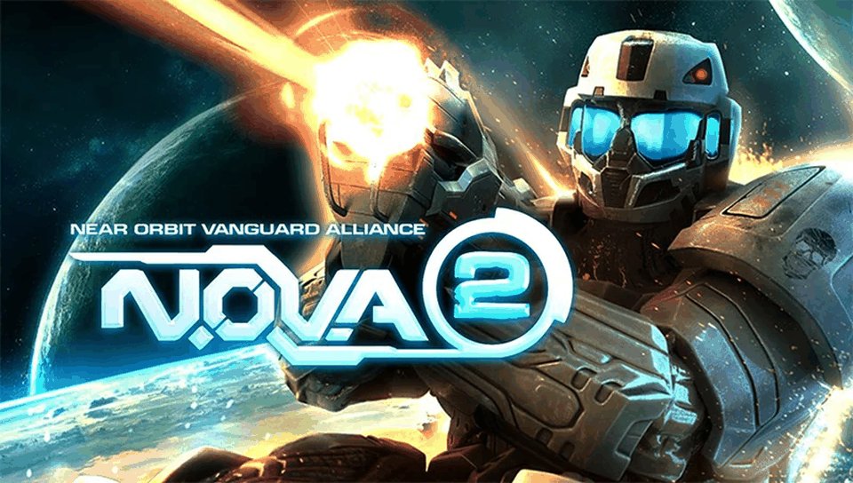

<h1 align="center">
  <br>
  N.O.V.A 2 · PS Vita Port
</h1>

<p align="center">
  <b>Native port of N.O.V.A. 2 – Near Orbit Vanguard Alliance HD (Gameloft) for PlayStation Vita and PlayStation TV.</b>
</p>

<p align="center">
  
  
  
  
  
  
</p>

<p align="center">
  <a href="#-description">Description</a> •
  <a href="#-features">Features</a> •
  <a href="#-controls">Controls</a> •
  <a href="#-installation">Installation</a> •
  <a href="#-known-issues">Known Issues</a> •
  <a href="#-building-from-source">Build</a> •
  <a href="#-credits">Credits</a>
</p>

---

## 📖 Description

**N.O.V.A. 2** is Gameloft's sci-fi first-person shooter, originally released for Android as
`NOVA-2-HD-v1-0-5.apk` (package `com.gameloft.android.GAND.GloftN2HP`, HD v1.0.5).

This port runs the compiled native library (`libnova2.so`, armeabi-v7a) from the Android release directly on the
PS Vita's ARM Cortex-A9 processor, using a dynamic loader (*soloader*) and an Android environment emulation layer
(*FalsoJNI*), with [vitaGL](https://github.com/Rinnegatamante/vitaGL) providing the GLES 2.0 rendering backend.
Nothing from the game is distributed here; you need your own APK and its data folder.

---

## 🎮 Status & Playability

**Status: Playable (v1.0.2)** — the game boots through the intro video, menus and campaign, and plays in-game at
60 FPS at the Vita's native 960x544 resolution, as stated in the v1.0 release notes. Exiting to the LiveArea was fixed
in v1.0.2.

- [x] **Loader**: `libnova2.so` runs natively with the soloader and FalsoJNI, in the Android activity order (`JNI_OnLoad` → `GLResLoader.nativeInit` → … → `GameRenderer.nativeRender()` loop).
- [x] **Graphics**: native 960x544 1:1, 60 FPS per the v1.0 release notes; ATC textures decoded in software.
- [x] **Intro video**: `GLVideo.mp4` plays unconverted through the port's own demuxer and the Vita's hardware H.264 decoder.
- [x] **Controls**: every HUD button is driven from the physical buttons through synthetic touches.
- [x] **Saves**: progress saves on a fresh install from v1.0.1 onwards (the port creates `ux0:data/nova2/saves/` at startup).
- [x] **Exit**: exiting from the main menu returns to the LiveArea (v1.0.2).
- [ ] **Changes after v1.0.2**: options menu (Select + Start), mech rockets, audio and shot-cut fixes, GLSL preprocessor fix and fatal-error capture are built, but not yet verified on console (see Known Issues).

### 📜 Changelog

- **v1.0.2: Exit fix.**
  - **Exiting from the main menu now returns to the LiveArea.** The game's exit button calls Android's
    `GLGame.Exit()`, which the port left empty, so the game froze on a black screen. It now closes the app like on Android.
  - **If the game suddenly crashes at boot after working fine before**, check that `ux0:data/nova2/libnova2.so` is
    intact by copying it again from the APK (`lib/armeabi-v7a/libnova2.so`). On the author's own console, 56 KB of that
    file got corrupted on the memory card, which made the game crash at startup with no code change. The same kind of
    corruption can also damage the `.gla` data files or the saves.

- **v1.0.1: Save hotfix.**
  - **Progress now saves on a fresh install.** The game saves to its Android data folder, which the port maps to
    `ux0:data/nova2/saves/`. The game never creates that folder (on Android it always exists), and the old README said it
    was created automatically. If it was missing, every save failed silently, so after a restart there was only "New Game"
    and no "Continue". The port now creates `ux0:data/nova2/saves/` at startup.
  - **Already playing?** Just install the new VPK. If `ux0:data/nova2/saves/` already existed on your card, your progress
    was being saved and is kept.
  - Note: like on Android, the game only saves at checkpoints and when a level is finished, not when pausing or quitting.

- **v1.0: Initial release.**
  - **Plays at 60 FPS at native 960x544**, 1:1 with the Vita screen. The engine is given the real resolution, so the 3D
    game and HUD fill the screen without scaling. The static 800x480 loading/title backgrounds are stretched to fullscreen
    at sprite level.
  - **Intro video plays unconverted.** `GLVideo.mp4` (H.264 Baseline 640x360 @ 60 fps + AAC 44.1 kHz) is played exactly as
    shipped with the game. SceAvPlayer refuses this file, so the port uses its own MP4 demuxer with the Vita's **hardware
    H.264 decoder** (`sceAvcdec`) and software AAC audio. Skip it with Cross or Start.
  - **Full physical controls.** Every visible HUD button is mapped to a physical button, using the button positions read
    from the game's own code (see [Controls](#-controls)).
  - **Virtual touch controls at 1% opacity.** The joystick, fire, jump and special-power buttons are nearly invisible but
    still respond to touch. The HUD that shows ammo and grenades stays fully visible.
  - **Smooth camera with adjustable sensitivity.** The right stick works like a continuous finger drag: hold it to keep
    turning, light tilt for precise aiming. Press **Select + D-Pad Up/Down** to set the sensitivity (1-10, default 4). A bar
    at the top of the screen shows the level, and the setting is saved in `ux0:data/nova2/camera_sens.txt`.
  - **Performance fixes.** Removed per-frame log writes and per-sound log spam. Added a negative cache for missing files:
    the engine looks for a loose `.wav` that does not exist before every footstep or gunshot, and that used to stall a frame
    each time.
  - Software ATC texture decoding, Vox audio through `sceAudioOut`, Gameloft DRM bypassed, and save/data paths remapped to
    `ux0:data/nova2/`.

---

## ✨ Features

| Feature | Status | Notes |
| :--- | :---: | :--- |
| Boots to gameplay | ✅ | Intro, menus and campaign (v1.0 and v1.0.2 release notes) |
| Graphics / renderer | ✅ | GLES 2.0 via vitaGL, native 960x544, ATC textures decoded in software |
| Audio & music | 🟡 | Vox mixer through `sceAudioOut`; sound-effect fixes after v1.0.2 not yet verified on console |
| Video / cutscenes | ✅ | Boot intro plays; later video requests are skipped |
| Physical buttons | ✅ | Full mapping, see [Controls](#-controls) |
| Analog sticks / camera | ✅ | Left stick moves, right stick camera with adjustable sensitivity |
| Touch screen | ✅ | Original touch controls, drawn at 1% opacity |
| Button remapping / port menu | 🧪 | Select + Start options menu (Phase 24): not yet tested on console |
| Save data | ✅ | Saves to `ux0:data/nova2/saves/` (fixed in v1.0.1) |
| Native trophies | ➖ | No trophies in this port |
| Languages | 🧪 | ❔ <!-- TODO: not documented in the repo --> |
| Performance | ✅ | 60 FPS at 960x544 per the v1.0 release notes; heavy combat may still hitch on slow memory cards |
| Online / IAP / ads | ➖ | Gameloft license check bypassed; online features not documented |
| PS TV | 🧪 | Not tested yet |

Legend: `✅ Working (verified on console) · 🧪 Implemented, not yet verified on console · 🟡 Partial · ❌ Not working · ➖ Not applicable · ❔ Not documented yet`

---

## 🎯 Controls

| Vita input | Action |
|---|---|
| Left Analog | Move |
| Right Analog | Camera (continuous drag, keeps turning while held; light tilt = precise aim) |
| R | Fire (hold) |
| L | Use special power (lightning) |
| Cross | Jump |
| Circle | Reload |
| Triangle / D-Pad Up | Next weapon |
| D-Pad Down | Previous weapon |
| D-Pad Left / Right | Change special power |
| Square | Throw grenade |
| Start | Pause |
| **Select + D-Pad Up / Down** | **Camera sensitivity** (1-10, default 4; a 10-block bar is shown at the top of the screen) |
| Touch screen | Original touch controls (still active, drawn at 1% opacity) |

In menus, the D-Pad, Circle, Triangle, Square, Start and Select are also sent as Android gamepad keys.

---

## 📋 Prerequisites

To run this port on your PS Vita or PS TV, you will need:

1. A PS Vita / PS TV on Custom Firmware (**HENkaku** / **h-encore** / **Enso**), 3.60–3.74.
2. [**kubridge**](https://github.com/TheOfficialFloW/kubridge/releases) and [**FdFix**](https://github.com/TheOfficialFloW/FdFix/releases)
   installed as kernel plugins (`ur0:tai/config.txt` under `*KERNEL`).
3. [**libshacccg.suprx**](https://github.com/Rinnegatamante/ShaRKBR33D/releases/latest) installed in `ur0:data/`
   ([extraction guide](https://samilops2.gitbook.io/vita-troubleshooting-guide/shader-compiler/extract-libshacccg.suprx)).
4. A legally obtained copy of **N.O.V.A. 2 HD v1.0.5** (`NOVA-2-HD-v1-0-5.apk`) **and** its downloaded game data folder
   (`/sdcard/gameloft/games/GloftN2HP/` from an Android device where the game was installed and run once).

---

## 📦 Installation

1. Install `nova2.vpk` on your console with **VitaShell**.
2. Extract `NOVA-2-HD-v1-0-5.apk` on your PC with any zip extractor.
3. Copy to `ux0:data/nova2/`:
   - `lib/armeabi-v7a/libnova2.so` from the APK → `ux0:data/nova2/libnova2.so`
   - `assets/data.save` from the APK → `ux0:data/nova2/assets/data.save`
   - `res/raw/*` from the APK → `ux0:data/nova2/res/raw/`
   - the whole Android data folder `GloftN2HP/` → `ux0:data/nova2/GloftN2HP/` (`*.gla`, `sounds_hi.glza`, `oconf.bar`, `GLVideo.mp4`, ...)
4. Launch **N.O.V.A 2** from the LiveArea.

`libStormGLOFT.so` and `libmthook.so` are **not** needed.

### Final File Structure in `ux0:data/nova2/`

```text
ux0:data/nova2/
├── libnova2.so            <- lib/armeabi-v7a/ from the APK
├── assets/
│   └── data.save          <- assets/ from the APK
├── res/
│   └── raw/               <- res/raw/ from the APK (igli.bin, data.txt, raw_000.ogg, ...)
├── GloftN2HP/             <- Android data folder, as-is
│   ├── GLVideo.mp4        <- intro video (played unconverted)
│   ├── sounds_hi.glza
│   ├── location_00X_*.gla, actors.gla, weapons.gla, menus.gla, ...
│   └── oconf.bar
├── saves/                 <- created at startup (*.dat)
├── shader_cache/          <- created at runtime
├── logs/                  <- one nova2_NNNN.log per boot
└── camera_sens.txt        <- camera sensitivity (created when you change it)
```

---

### ⚙️ Options

| Setting | Default | Meaning |
| :--- | :---: | :--- |
| Camera sensitivity | `4` | 1–10, changed with **Select + D-Pad Up / Down**; saved to `ux0:data/nova2/camera_sens.txt` |

---

## 🐛 Known Issues

- **Intro only**: only the boot intro video is supported. If the intro is played more than once in a session (it only plays
  on boot), later videos are skipped. After the intro, the physically contiguous memory it used is handed to vitaGL.
- **HUD touch spots**: the pause, weapon and grenade HUD buttons are 3D HUD nodes with no fixed coordinates in code. Their
  touch spots were measured from gameplay screenshots. If one of them misses, the log (`[syntouch] gesture ...`) shows where
  it tapped.
- **Sound effects**: they are streamed from `sounds_hi.glza` with a file open per sound; heavy combat can still cause small
  hitches on slow memory cards.
- **Not yet verified on console (built after v1.0.2)**: the Select + Start options menu and the Interact / hidden-control
  changes (Phase 24), mech rockets, liquids and sound (Phase 25), core split (Phase 26), the `UnregisterEmitter` crash fix
  (Phase 27), the shot-cut audio fix (Phase 28), the GLSL preprocessor and silent-fire loop fix (Phase 29), and the fatal
  error catcher (Phase 30). See `port_progress.md`.

### 🩺 Troubleshooting

**"Looks like you haven't installed the data files" on boot:** `ux0:data/nova2/libnova2.so` is missing or in the wrong folder.

**Black screen / crash while loading:** check that `ux0:data/nova2/GloftN2HP/` contains all the `.gla` files and
`sounds_hi.glza`, and that `kubridge`, `fd_fix` and `libshacccg.suprx` are installed.

**If it still crashes**, please report it with:

1. The newest `ux0:data/nova2/logs/nova2_NNNN.log` (from the time of the crash; do not delete it).
2. The newest `ux0:data/psp2core-*-eboot.bin.psp2dmp` core dump.
3. A note on exactly when it happens (boot, intro, menu, which level).

---

## 🔨 Building from Source

This port does **not** keep a local copy of `porting_tools/`: build, deploy, logs, LiveArea and crash-dump workflows
are handled by **psvita-port-toolkit**, a standalone tool kept outside this repository.

### Build Prerequisites

- **VitaSDK** (softfp), with `kubridge`, `pthread` and the vita-portlibs **ffmpeg** package (`avcodec`, `avutil`,
  `swresample`, `mp3lame`; used only for the intro's AAC audio).
- vitaGL is vendored in `lib/vitagl` and built automatically with the project's make flags.
- CMake and Make (or Ninja).

### Build Steps

```bash
git clone https://github.com/MetalSyntax/N.O.V.A-2-vita.git
cd N.O.V.A-2-vita
git submodule update --init
cmake -B build -DCMAKE_BUILD_TYPE=Release
cmake --build build
```

This produces `build/nova2.vpk`. A `Debug` build keeps the full loader log in `ux0:data/nova2/logs/`. For day-to-day
development use `psvita-toolkit build` / `deploy`.

## 📁 Project Structure

- `source/main.c`: lifecycle, render loop, input mapping (sticks, buttons → synthetic touches, camera sensitivity OSD).
- `source/patch.c`: DRM bypass, SWP fix, 800x480 background stretch, 1% virtual-control opacity.
- `source/video_avc.c`: MP4 demuxer + `sceAvcdec` hardware H.264 + AAC intro player.
- `source/video.cpp`: SceAvPlayer fallback player (adapted from the Dungeon Hunter 2 port).
- `source/reimpl/`: libc/Android reimplementations (path remapping, negative `fopen` cache, logging, pthreads, ATC decoder, EGL layer).
- `lib/`: `so_util`, `falso_jni`, `libc_bridge`, `fios`, `kubridge`, `sha1`, vendored `vitagl`.
- `extras/`: LiveArea assets, `cpuinfo`/`meminfo`, scripts.
- `PORTING_PLAN.md`: living plan: engine findings, JNI table, data layout.
- `port_progress.md`: bug-by-bug diagnosis log, one confirmed bug at a time.
- `RELEASE.md`: v1.0.2 release notes.

---

## 📜 Disclaimer

**N.O.V.A.** and **Gameloft** are registered trademarks of Gameloft. The work presented in this repository is not
"official" or produced or sanctioned by Gameloft or any other registered trademark mentioned in this repository.

This software does not contain the original code, executables, assets, or other non-redistributable parts of the
original game product. The authors of this work do not promote or condone piracy in any way. To launch and play the game
on their PS Vita device, users must possess their own legally obtained copy of the game in the form of an `.apk` file
and its data.

---

## ☕ Support My Work

This project is **free** and will stay free. If you enjoy it, a tip from **$1** helps me keep porting games to the PS Vita:

<p align="center">
  <a href="https://ko-fi.com/metalsyntax"></a>
</p>

- **Ko-fi:** [ko-fi.com/metalsyntax](https://ko-fi.com/metalsyntax)
- **PayPal:** [paypal.me/MetalSyntax](https://paypal.me/MetalSyntax)
- **Bitcoin (BTC):** `133HdCsaWxdjTfmwpgGVykByhNBV338uRc`

**Ko-fi supporters get:**
- **Early access** to new ports before their public release (test builds of upcoming projects).
- **Data preparation scripts and step-by-step guides** to set up your own game files for each new port.
- A say in which games I port next.

> Game files are never distributed. You always need your own legally obtained copy of the game.

---

## 👥 Credits

- **Gameloft**: original developers of N.O.V.A. 2.
- **MetalSyntax**: this port.
- **TheFloW**: `so_util`, `kubridge`, `FdFix`, and the foundational techniques for loading Android executables on PS Vita.
- **Rinnegatamante**: `vitaGL` and continued support to the PS Vita porting scene.
- **v-atamanenko**: `FalsoJNI` and the `soloader-boilerplate` base template.
- **Vita Community**: all developers and enthusiasts in the PS Vita homebrew community.

---

## 📄 License

The loader is licensed under the MIT license — see the [LICENSE](LICENSE) file. The game, its assets and its data remain the
property of Gameloft and are not distributed with this project.
