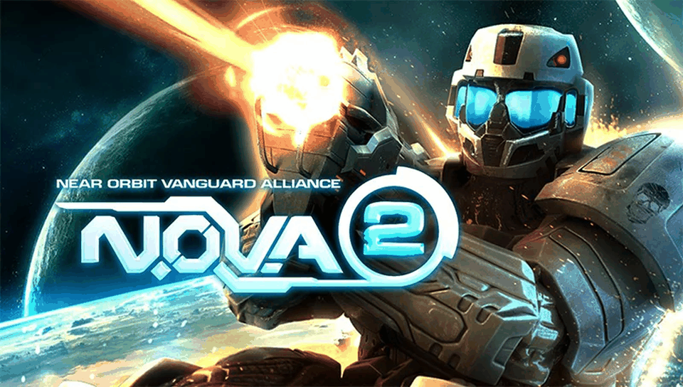

# N.O.V.A 2 — PS Vita Port

<p align="center">
  
</p>

<p align="center">
  <b>Native port of N.O.V.A. 2 – Near Orbit Vanguard Alliance HD (Gameloft) for PlayStation Vita and PlayStation TV.</b>
</p>

<p align="center">
  
  
  
  
  
</p>

---

## 📖 Description

**N.O.V.A. 2** is Gameloft's sci-fi first-person shooter, originally released for Android as
`NOVA-2-HD-v1-0-5.apk` (package `com.gameloft.android.GAND.GloftN2HP`). This port runs the
compiled native library (`libnova2.so`, armeabi-v7a) from the Android release directly on the
PS Vita's ARM Cortex-A9 processor, using a dynamic loader (*soloader*) and an Android
environment emulation layer (*FalsoJNI*), with [vitaGL](https://github.com/Rinnegatamante/vitaGL)
providing the GLES 2.0 rendering backend.

### 🎮 Current Status: Playable

The game boots through the intro video, menus and campaign, and plays **in-game at 60 FPS**
at the Vita's native 960x544 resolution. See [`port_progress.md`](port_progress.md) for the
full bug-by-bug history.

### ✨ What Works

- **Native ARM Execution**: `libnova2.so` (armeabi-v7a) runs directly on the Vita's CPU via
  the soloader, no interpretation/emulation of game code.
- **Full JNI lifecycle bootstrap**, in the same order as the Android activity
  (`JNI_OnLoad` → `GLResLoader.nativeInit` → `GLMediaPlayer.nativeInit` →
  `Device.nativeInit` → `GLGame.nativeInit` → `GameRenderer.nativeInit/nativeResize`), then a
  continuous `GameRenderer.nativeRender()` loop.
- **Native 960x544, 1:1**: the engine is told the real screen size, so the 3D game and HUD
  fill the screen without scaling; static 800x480 loading/title backgrounds are stretched at
  sprite level (`CSprite::PaintFrame`).
- **vitaGL built from source** with the Gameloft GLSL flags and a shader cache
  (`ux0:data/nova2/shader_cache/`).
- **ATC textures**: the game ships ATC-compressed textures only; they are decoded in software
  at load time.
- **Audio**: the engine's Vox mixer (`AudioTrack`) is routed to `sceAudioOut` (44.1 kHz).
- **Intro video, unconverted**: `GLVideo.mp4` (H.264 Baseline 640x360 @ 60 fps + AAC 44.1 kHz)
  plays **as shipped**. It is decoded by the Vita's hardware H.264 decoder (`sceAvcdec`) through
  its own MP4 demuxer, with AAC decoded in software. SceAvPlayer rejects this file, so it is not
  used for it. Skippable with Cross / Start.
- **Full physical controls**: every on-screen button is driven from the physical buttons through
  synthetic touches at the engine's own button rects. The virtual touch controls are drawn at
  **1% opacity** but still work if you touch them.
- **Adjustable camera sensitivity** (right stick), saved between sessions.
- **DRM bypassed**: Gameloft `ALicenseCheck` is patched out.
- **Saves**: `/data/data/<pkg>` and `/sdcard/gameloft/games/GloftN2HP` are remapped to
  `ux0:data/nova2/`.

### 🕹️ Controls

| Vita input | Action |
|---|---|
| Left Analog | Move |
| Right Analog | Camera (continuous drag, keeps turning while held; light tilt = precise aim) |
| R | Fire (hold) |
| L | Use special power (lightning) |
| Cross | Jump |
| Circle | Reload |
| Triangle / D-Pad Up | Next weapon |
| D-Pad Down | Previous weapon |
| D-Pad Left / Right | Change special power |
| Square | Throw grenade |
| Start | Pause |
| **Select + D-Pad Up / Down** | **Camera sensitivity** (1-10, default 4; a 10-block bar is shown at the top of the screen) |
| Touch screen | Original touch controls (still active, drawn at 1% opacity) |

In menus, the D-Pad, Circle, Triangle, Square, Start and Select are also sent as Android gamepad
keys.

### ⚠️ Known Issues

- If the intro is played more than once in a session (it only plays on boot), later videos are
  skipped. After the intro, the physically contiguous memory it used is handed to vitaGL.
- The pause, weapon and grenade HUD buttons are 3D HUD nodes with no fixed coordinates in code.
  Their touch spots were measured from gameplay screenshots. If one of them misses, the log
  (`[syntouch] gesture ...`) shows where it tapped.
- Sound effects are streamed from `sounds_hi.glza` with a file open per sound; heavy combat can
  still cause small hitches on slow memory cards.

---

## 📋 Prerequisites

To run this port on your PS Vita or PS TV, you will need:

1. A PS Vita / PS TV on Custom Firmware (**HENkaku** / **h-encore** / **Enso**), 3.60-3.74.
2. [**kubridge**](https://github.com/TheOfficialFloW/kubridge/releases) and
   [**FdFix**](https://github.com/TheOfficialFloW/FdFix/releases) installed as kernel plugins
   (`ur0:tai/config.txt` under `*KERNEL`).
3. [**libshacccg.suprx**](https://github.com/Rinnegatamante/ShaRKBR33D/releases/latest) installed
   in `ur0:data/` ([extraction guide](https://samilops2.gitbook.io/vita-troubleshooting-guide/shader-compiler/extract-libshacccg.suprx)).
4. A legally obtained copy of **N.O.V.A. 2 HD v1.0.5** (`NOVA-2-HD-v1-0-5.apk`) **and** its
   downloaded game data folder (`/sdcard/gameloft/games/GloftN2HP/` from an Android device where
   the game was installed and run once).

---

## 📦 Installation Instructions

1. Install `nova2.vpk` on your console with **VitaShell**.
2. Extract `NOVA-2-HD-v1-0-5.apk` on your PC with any zip extractor.
3. Copy to `ux0:data/nova2/`:
   - `lib/armeabi-v7a/libnova2.so` from the APK → `ux0:data/nova2/libnova2.so`
   - `assets/data.save` from the APK → `ux0:data/nova2/assets/data.save`
   - `res/raw/*` from the APK → `ux0:data/nova2/res/raw/`
   - the whole Android data folder `GloftN2HP/` → `ux0:data/nova2/GloftN2HP/`
     (`*.gla`, `sounds_hi.glza`, `oconf.bar`, `GLVideo.mp4`, ...)
4. Launch **N.O.V.A 2** from the LiveArea.

### Final File Structure in `ux0:data/nova2/`

```text
ux0:data/nova2/
├── libnova2.so            <- lib/armeabi-v7a/ from the APK
├── assets/
│   └── data.save          <- assets/ from the APK
├── res/
│   └── raw/               <- res/raw/ from the APK (igli.bin, data.txt, raw_000.ogg, ...)
├── GloftN2HP/             <- Android data folder, as-is
│   ├── GLVideo.mp4        <- intro video (played unconverted)
│   ├── sounds_hi.glza
│   ├── location_00X_*.gla, actors.gla, weapons.gla, menus.gla, ...
│   └── oconf.bar
├── saves/                 <- created at startup (*.dat)
├── shader_cache/          <- created at runtime
├── logs/                  <- one nova2_NNNN.log per boot
└── camera_sens.txt        <- camera sensitivity (created when you change it)
```

`libStormGLOFT.so` and `libmthook.so` are **not** needed.

---

## 🛠️ Building from Source

This port does **not** keep a local copy of `porting_tools/`: build, deploy, logs, LiveArea
and crash-dump workflows are handled by **psvita-port-toolkit**, a standalone tool kept
outside this repository (open it and pick *"Continuar con un port existente"* pointing at this
folder).

### Build Prerequisites

- **VitaSDK** (softfp), with `kubridge`, `pthread` and the vita-portlibs **ffmpeg** package
  (`avcodec`, `avutil`, `swresample`, `mp3lame`; used only for the intro's AAC audio).
- vitaGL is vendored in `lib/vitagl` and built automatically with the project's make flags.
- CMake and Make (or Ninja).

### Build Steps

```bash
git submodule update --init
cmake -B build -DCMAKE_BUILD_TYPE=Release
cmake --build build
```

This produces `build/nova2.vpk`. A `Debug` build keeps the full loader log in
`ux0:data/nova2/logs/`. For day-to-day development use `psvita-toolkit build` / `deploy`.

---

## 🏗️ Project Structure

- `source/main.c`: lifecycle, render loop, input mapping (sticks, buttons → synthetic touches,
  camera sensitivity OSD).
- `source/patch.c`: DRM bypass, SWP fix, 800x480 background stretch, 1% virtual-control opacity.
- `source/video_avc.c`: MP4 demuxer + `sceAvcdec` hardware H.264 + AAC intro player.
- `source/video.cpp`: SceAvPlayer fallback player (adapted from the Dungeon Hunter 2 port).
- `source/reimpl/`: libc/Android reimplementations (path remapping, negative `fopen` cache,
  logging, pthreads, ATC decoder, EGL layer).
- `lib/`: `so_util`, `falso_jni`, `libc_bridge`, `fios`, `kubridge`, `sha1`, vendored `vitagl`.
- `extras/`: LiveArea assets, `cpuinfo`/`meminfo`, scripts.
- `PORTING_PLAN.md`: living plan: engine findings, JNI table, data layout.
- `port_progress.md`: bug-by-bug diagnosis log, one confirmed bug at a time.

---

## ⚖️ Disclaimer

**N.O.V.A.** and **Gameloft** are registered trademarks of Gameloft. The work presented in this
repository is not "official" or produced or sanctioned by Gameloft or any other registered
trademark mentioned in this repository.

This software does not contain the original code, executables, assets, or other
non-redistributable parts of the original game product. The authors of this work do not
promote or condone piracy in any way. To launch and play the game on their PS Vita device,
users must possess their own legally obtained copy of the game in the form of an `.apk` file
and its data.

---

## 👥 Credits and Acknowledgements

- **Gameloft**: original developers of N.O.V.A. 2.
- **TheFloW**: `so_util`, `kubridge`, `FdFix`, and the foundational techniques for loading
  Android executables on PS Vita.
- **Rinnegatamante**: `vitaGL` and continued support to the PS Vita porting scene.
- **v-atamanenko**: `FalsoJNI` and the `soloader-boilerplate` base template.
- **Vita Community**: all developers and enthusiasts in the PS Vita homebrew community.

---

## License

This software may be modified and distributed under the terms of the MIT license.
See the [LICENSE](LICENSE) file for details.
